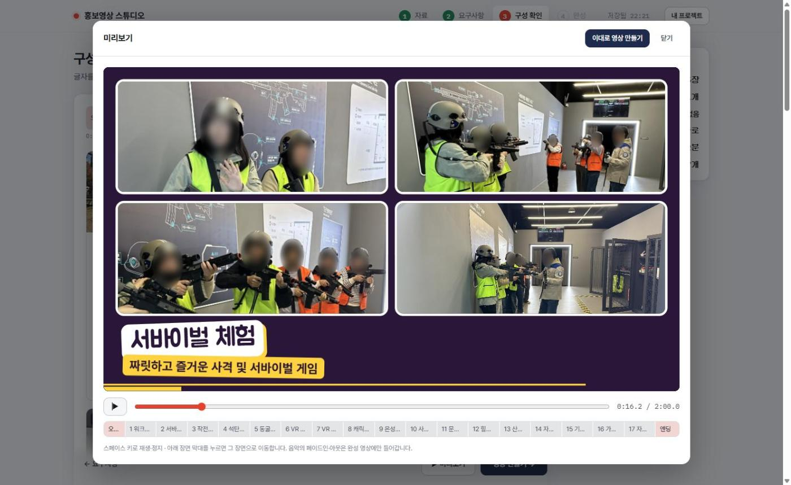
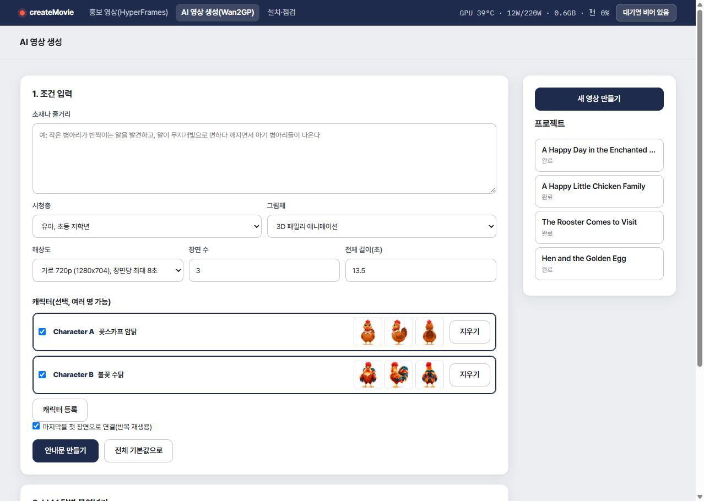
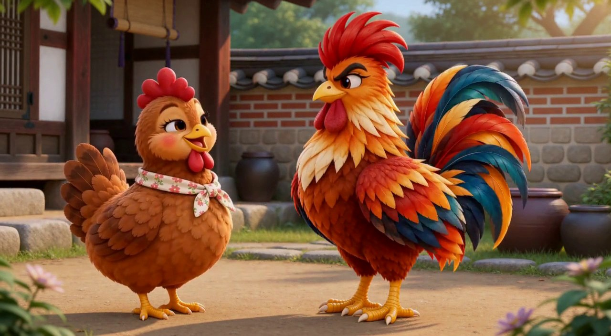
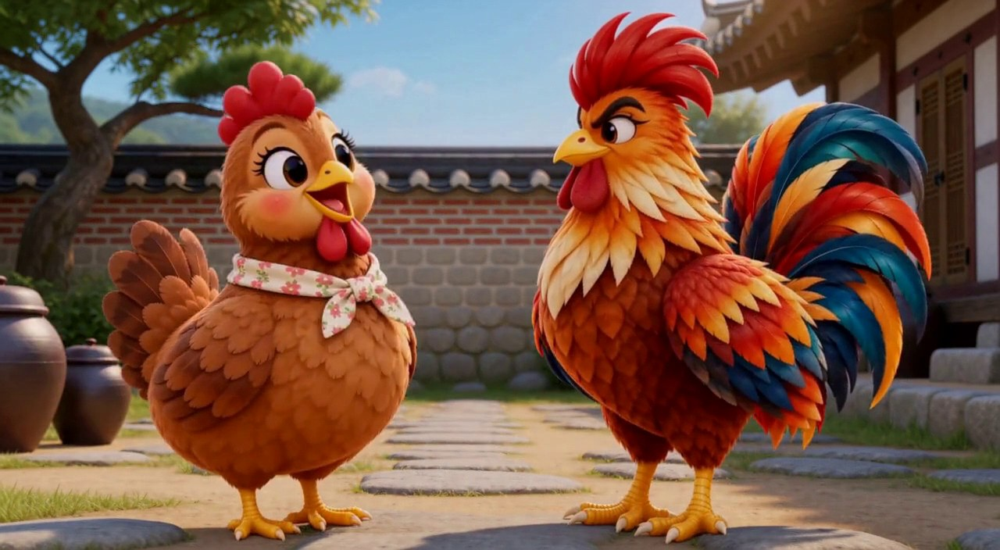

# createMovie

사진·배경음악을 올리면 AI(Gemini)가 장면을 구성하고 [HyperFrames](https://github.com/heygen-com/hyperframes)로 홍보 영상(MP4)을 렌더링하고, NVIDIA GPU가 있는 PC에서는 [Wan2GP](https://github.com/deepbeepmeep/Wan2GP)의 MiniMax H3로 AI 영상도 만드는 웹 서비스.

- AI 영상 생성: 내 캐릭터 이미지 등록·여러 캐릭터 선택, 그림체·시청층 선택, 장면 연결, 진행 상황과 GPU 상태 표시
- 폴더째 드래그앤드롭 업로드, 배경음악 구간 편집, 영상 길이 15~600초
- AI 장면 구성·수정 요청, 장면별 화면 전환 효과, 브라우저 미리보기
- 가로(16:9)/세로(9:16), 한국어 내레이션(edge-tts), 프로젝트 저장·불러오기

## 연출 스타일 · 장면 유형
- **연출 스타일 4종**: 클래식 / 팝(귀엽고 경쾌) / 시네마틱(차분하고 진지, 레터박스) / 키네틱(빠르고 강렬, 글자 단위 등장).
  글꼴·색·글자 등장·사진 움직임·전환 묶음·속도가 한 벌로 바뀝니다. 요구사항 단계에서 고르거나 AI 추천에 맡기고, 구성 단계에서 언제든 바꿀 수 있어요.
- **장면 유형 5종**: 기본 / 사진 콜라주 / 큰 숫자 / 인용·후기 / 목록·일정. 숫자·후기는 요구사항에 실제로 적힌 내용만 씁니다.
- **장면 배치 A/B**: 같은 유형도 배치가 2가지(분할 화면, 폴라로이드, 카드형 목록 등)라 영상마다 반복 느낌이 줄어요.
- **박자 맞춤 편집**: 배경음악을 올리면 템포(BPM)와 마디를 자동으로 찾아, 장면이 바뀌는 순간을 비트(가능하면 마디 첫 박)에 맞춥니다. 음악 패널에서 끌 수 있어요.
- **동영상 클립**: MP4·MOV를 사진처럼 올려 장면에 쓸 수 있어요(배경음악과 섞이도록 소리는 끔). 장면보다 짧으면 천천히 재생하고 마지막 장면에서 멈춥니다.
- **얼굴 모자이크**: 사진과 동영상 클립 속 얼굴을 찾아 흐리게 처리(외부 게시용). 자동 감지라 옆모습 등을 놓칠 수 있으니 완성본을 확인하세요.
- **세로 자동 맞춤**: 얼굴 위치를 기준으로 잘라 쇼츠·릴스에서 인물이 잘리지 않게 합니다.
- **로고**: 기관 로고를 올리면 오프닝·엔딩과 장면 구석에 넣어요(흰 배경 자동 제거).
- **자막**: 내레이션을 화면 자막으로 함께 넣어요(소리 없이 보는 SNS용).
- **가로 + 세로 동시 출력**: 한 번에 두 영상과 각각의 썸네일 이미지를 만듭니다.
- 글꼴은 `python tools/get_fonts.py`로 한 번 내려받으면(도커는 자동), 영상에 쓰인 글자만 잘라 넣기 때문에 렌더하는 PC에 글꼴을 설치할 필요가 없습니다.
- 배경음악이 없을 때는 `python tools/make_bgm.py bgm.wav 40`으로 저작권 걱정 없는 경쾌한 음악(128BPM)을 만들 수 있어요.

## 실행
**자동 설치(Windows 10/11)**: `setup.bat`을 더블클릭합니다. Python 3.11+, Node.js 22+, FFmpeg, Git이 없으면 winget으로 설치하고, 패키지·글꼴·렌더링 엔진을 받고, Gemini API 키를 물은 뒤 바탕화면 바로가기를 만듭니다. 이미 있는 것은 건너뛰므로 여러 번 실행해도 됩니다. NVIDIA GPU가 있으면 AI 영상 생성 도구(약 80GB)도 설치할지 묻습니다(`setup.bat -H3`는 묻지 않고 설치).

실행은 바탕화면 **createMovie** 또는 `start.bat`입니다. `http://localhost:5000`이 열립니다. 상단 메뉴의 **설치·점검**에서 도구별 상태와 설치 안내를 볼 수 있습니다.

**직접 설치**
```
pip install -r requirements.txt
python tools/get_fonts.py   # 영상용 한글 글꼴·얼굴 인식 모델(처음 한 번)
echo GEMINI_API_KEY=발급받은키 > .env
python server.py   # http://localhost:5000
python tools/setup_h3.py   # AI 영상 생성까지 쓸 때(NVIDIA GPU 8GB 이상, 약 80GB)
```

**서비스 구성**: 사진 홍보 영상(`/`)과 AI 영상 생성(`/h3`)이 한 서버에서 돕니다.
- **대기열 하나**: 이 PC에서 하는 작업은 종류와 상관없이 넣은 순서대로 하나씩 처리해 서로 겹치지 않습니다. 상단 대기열에서 보고, 빼고, 멈추고, 재개합니다. 재시작해도 남습니다. 워커 모드의 홍보 영상 렌더는 다른 PC에서 돌기 때문에 이 대기열에 서지 않습니다.
- **GPU가 없을 때**: AI 영상 생성 화면에 쓸 수 없는 이유를 안내하고 생성을 막습니다. 홍보 영상은 그대로 쓸 수 있고, 완성된 AI 영상은 볼 수 있습니다.
- **접속 범위**: `HOST=0.0.0.0`이어도 AI 영상 생성과 대기열 조작은 서버가 실행 중인 PC에서만 됩니다.
- **AI 영상을 홍보 영상에**: AI 영상 프로젝트의 **홍보 영상에 넣기**를 누르면 그 영상을 클립으로 넣은 새 홍보 영상 프로젝트가 만들어집니다.

## NAS + PC 렌더 워커 구성 (권장)
영상 렌더링은 CPU를 많이 써서, 사양이 낮은 NAS에서는 화면·AI 구성·저장만 하고 렌더링은 PC가 맡습니다.
PC가 NAS에 일감을 물어보는 방식이라 공유기 포트를 열 필요가 없고, PC가 꺼져 있으면 켜질 때까지 대기열에 남아 있습니다.

**1. NAS (Synology Container Manager)**
- 이 저장소를 NAS 폴더에 받고, 같은 폴더에 `.env` 작성:
  ```
  GEMINI_API_KEY=발급받은키
  WORKER_TOKEN=아무도-모르는-긴-문자열
  ```
- Container Manager > 프로젝트 > 생성 > `docker-compose.yml` 선택 > 빌드·실행
- 폰/PC 브라우저에서 `http://NAS주소:5000` 접속

**2. PC (Windows 10/11)**
- 브라우저에서 `http://NAS주소:5000/worker.zip` 내려받아 압축 풀기
- `setup-worker.bat` 더블클릭 → Node.js·FFmpeg 자동 설치, 토큰 입력, 시작 프로그램 등록까지 한 번에
- 이후 윈도우를 켜면 워커가 최소화 상태로 자동 실행됩니다(바탕화면 바로가기로도 실행 가능)
- macOS/Linux: Node.js 22+·FFmpeg 설치 후 `node worker.mjs --setup`, `node worker.mjs`

`WORKER_TOKEN`을 비워 두면 예전처럼 서버가 직접 렌더링합니다(PC 한 대로 쓸 때). 다른 기기에서 접속하려면 `.env`에 `HOST=0.0.0.0`.

---

# 개발일지

저장소: https://github.com/kjt7942/createMovie

## 목적
기관·단체의 행사 사진 폴더와 배경음악만 있으면, 영상 편집 지식 없이 홍보 영상(MP4)을 만들 수 있게 하는 것.
사진 폴더 하나가 장면 하나가 되고(`server.py` 프롬프트: "폴더 하나가 장면 하나"), 제목·슬로건·장면 문구는 Gemini가 사진 내용과 요구사항을 보고 짜 준다.
렌더링 CPU 부담이 커서 저사양 NAS에서도 쓸 수 있도록 화면·AI·저장(NAS)과 렌더링(PC)을 분리했다.

## 기획 단계
Claude 앱 대화(공유 링크 `https://claude.ai/share/abda216f-ffda-4657-8928-6f06f75ddf66`)에서 시작했다. 아래는 사용자가 보낸 메시지 원문이다(순서대로).

**① 최초 질문 — 서비스 가능 여부 (저장소 링크 `https://github.com/kjt7942/createMovie` 와 함께)**
> 이거 깃허브에서 서비스 할수있어?
> 그리고 ai가 필요한부분에서 사용자가 구독하는 ai를 연결할수있어?

→ 답변 요지: GitHub Pages는 정적 HTML만 가능해 불가, 구독형 AI는 API 권한이 없어 직접 연결 불가. 대안으로 사용자 API 키 입력(BYOK), NAS/VPS 배포 제시.

**② AI 엔진 관련**
> 그럼 이 소스코드를 내려받아서 클로드코드에서 실행하고, ai도 클로드코드를 이용하는건 가능하지?

**③ 모바일 / 앱화**
> 내 스마트폰에서 실행하려면 수정을 많이해야돼?

> 이걸 앱으로만들면?

**④ 부하 문제 → PC 렌더 워커 구조 결정**
> 기존 프로젝트를 나스에서 돌리면 부하가 많이 걸리는거 아냐?

> 나스는 사양이 낮아서 부하높은 서비스는 올리기힘들어
> 서비스는 나스에 하되, 부하가 걸리는작업은 pc에서 처리하도록 하는게 가장 맞을거같은데! 대신 pc에 설치할게 있다면 쉽게 처리할수있게 준비해야하겠다.

**⑤ 영상 포맷 다양화 요구 (장면 유형 도입의 계기)**
> 그리고 지금 영상제작하는 포맷이 항상 똑같은거 아니야?
> 타이틀,내용 형식의 반복이잖아!
> 다양한 포맷으로 동영상제작이 가능해야 주제에 맞게 변화를 줄수있을거같은데?!

**⑥ 샘플 영상 제작 요청 (축제 사진 업로드)**
> 얼마전 축제관련 사진이야.
> 모든 장면유형을 활용해서 샘플영상 만들어줘.
> 화려하고 스피디한 장면전환효과를 다양하게 섞어서 세련되게 생성해줘. 가능하다면 영상에 맞는 배경음악도 넣어줘.

**⑦ 애니메이션 반복 지적 → 연출 스타일 도입**
> 영상확인했어.
> 매번 생성하는 영상의 애니메이션 구성이 항상 비슷한데, 같은주제라서 그런거야? 아님 이렇게밖에 못하는거야?

> 지금 테스트영상을 또 뽑을필요는 없고, 서비스에 적용해줘

> 계속 진행해

**⑧ 추가 기능 선정** (Claude가 제안한 11개 중 선택)
> 더 필요한게 뭐가있을까?

> 4,5,6,7,8,9번 진행

→ 4 얼굴 모자이크 · 5 동영상 클립 · 6 로고 · 7 자막 · 8 세로 자동 맞춤 · 9 가로+세로 동시 출력·썸네일

**⑨ 화면 확인**
> 서비스 화면 볼수있어?

**⑩ 로컬 AI 영상(H3) 도입** (Claude Code 세션, 2026-10-31~11-01)
> 영상 잘 만들어졌어! 이렇게 만들어지는 과정에서 클로드 니가 관여해야하는 부분이 있어?

> 이런 영상생성 진행상황을 눈으로 확인할 수 있게 프로그램을 만들고싶어. 스토리 및 프롬프트는 조건을 안내하고, 실제 스크립트는 무료LLM을 활용해서 작성후 복붙한다. 나머지 설정계산, 실행은 자동화하고, 오류대응은 최대한 오류가 안생기도록 개선해나가고, 결과검수는 내가 확인한다. 가능하겠어?

> 지금은 스크립트 작성후 영상 생성하는 과정까지 한번에 하나씩만 가능한데, 대기시간이 너무 오래걸려. 내가 스크립트 작성을 여러개 해놓고, 대기열에 쌓아놓으면 순서대로 처리되도록 시스템을 개선하자.

**⑪ 두 서비스 통합**
> 2가지 영상제작 서비스를 하나로 합쳐서 통합하자. 어떻게 합치면 좋을지 제안해줘

> 모든 작업을 대기열하나로 관리하도록해서 겹침문제 해결하고, gpu가 없는 환경에서는 H3생성을 사용할 수 없다는 안내를 하도록하자.
> 또한 필요한 도구들은 설치가이드를 제공하고, 서비스를 사용하는데 필요한 도구설치를 자동화하도록 하자.

> 그리고 각 서비스 화면이 하나의 서비스인것처럼 일관성을 갖도록 하자. 지금은 다른서비스를 붙여놓은거같아!

**⑫ 검수와 캐릭터 일관성**
> 전체 서비스를 검수하고 최적화작업을 진행해. 작은작업은 하이쿠나 소넷모델을 사용해. 점검하면서 추가할 사항이 있으면 정리해서 보고해줘. 난 나갔다올게.

> 이런 내가 만든 캐릭터를 제공하고 일관성있는 캐릭터를 유지하면서 영상을 생성하려면 어떻게 해야하지?

> 90도가 넘어가면 작업을 약간 느리게해서 온도를 관리할 수는 없어?

> 캐릭터가 여러개인 경우 어떻게 해야돼?

## 기술 스택 및 선택 이유
| 영역 | 사용 | 이유(코드 근거) |
|---|---|---|
| 서버 | Python · Flask | 업로드·AI 호출·대기열을 한 파일(`server.py`)로 처리 (이후 대기열 본체는 `studio/engine.py`로 옮겨 AI 영상 생성과 함께 쓴다.) |
| 영상 | HyperFrames(HTML + GSAP 타임라인) | 장면을 HTML/CSS로 쓰고 `data-start`/`data-duration`으로 시간 지정 (`composer.py`) |
| AI | Gemini (모델 3종 순차 폴백, 키 여러 개 순환) | 사진을 직접 보고 장면·문구 구성 (`server.py`의 `gemini()`) |
| 내레이션 | edge-tts | 무료·키 불필요, 한국어 3종 목소리 |
| 음악 박자 | numpy 기반 분석 (`beats.py`) | 장면 전환을 비트에 맞춤 |
| 얼굴 | YuNet ONNX (`media.py`) | 세로 자동 맞춤·얼굴 모자이크 |
| 렌더 워커 | Node.js 22+ · FFmpeg (`worker/worker.mjs`) | 외부 패키지 없이 PC에서 렌더 후 서버로 업로드 |
| 배포 | Docker (Synology Container Manager) | NAS 상시 실행 |
| AI 영상 | Wan2GP · MiniMax H3 (`FL2VA`, 캐릭터는 `Ref2VA`), Stable Audio 3 | 8GB GPU에서 로컬 생성. 첫·끝 프레임으로 장면을 잇고, 참고 이미지로 캐릭터를 유지 (`studio/engine.py`) |
| 스크립트 작성 | 사용자가 쓰는 무료 LLM에 안내문 복붙 | 별도 API 비용 없이 쓰고, 결과 JSON은 서버에서 검사 (`llm_prompt`, `validate_script`) |
| GPU 관리 | `nvidia-smi`, Windows `NtSuspendProcess` | 전력·클럭 제한과 감시, 과열 시 프로세스를 얼려 식힘 (`tools/gpu-safe.ps1`, `suspend_tree`) |

## 개발 기록 (git 커밋 시각 기준)
| 시각 | 내용 |
|---|---|
| 10/29 18:01 | 첫 커밋. HyperFrames 기반 홍보영상 제작 웹서비스(업로드 → AI 구성 → 렌더 → 미리보기) |
| 10/30 00:26 | 렌더링을 PC 워커로 분리. NAS는 화면·AI·저장만, PC가 `/claim`으로 일감을 가져가는 방식 |
| 10/30 00:38 | 장면 유형 5종(기본·콜라주·큰 숫자·인용·목록)과 빠른 전환 3종(휙·플래시·회전 줌), 무료 BGM 생성기 |
| 10/30 01:20 | 연출 스타일 4종·장면 배치 A/B·장면 유형 편집 화면. 템플릿 로직을 `composer.py`로 분리 |
| 10/30 09:22 | 배경음악 박자 분석(`beats.py`)으로 장면 전환을 비트에 맞춤 |
| 10/30 10:05 | 동영상 클립, 얼굴 모자이크, 세로 자동 맞춤, 로고, 자막, 가로+세로 동시 출력 |
| 10/30 21:57 | Gemini API 키 여러 개를 호출마다 돌려 쓰고 실패 시 다음 키로 재시도 |
| 10/30 22:07 | 콜라주 장면 챕터 진행바가 전체 진행바와 겹치는 문제 수정 |
| 11/01 11:33 | H3 Studio 로컬 AI 영상 생성과 대기열, 내보내기 도구 |
| 11/01 11:59 | 홍보 영상과 AI 영상 생성을 한 서비스로 통합 |
| 11/01 22:29 | 캐릭터 등록과 여러 캐릭터 선택, 온도 일시정지, 그림체·시청층 선택, 전체 검수 반영 (브랜치 `feat/character-reference-video`) |

## 트러블슈팅 · 배운 점
- **영상이 매번 똑같아 보임**: 초기에는 `base_template.html` 하나로 오프닝 → 번호+제목 → 엔딩 구조가 고정이었다. 연출 스타일 4종, 장면 유형 5종, 배치 A/B를 도입해 조합이 달라지게 했다(`composer.py`).
- **AI 사용량 한도**: 모델 3종을 순서대로 시도하던 것에 더해, `.env`의 `GEMINI_API_KEY`, `GEMINI_API_KEY_2`… 를 호출마다 시작 키를 바꿔 쓰고 실패하면 다음 키로 넘어가게 했다(`server.py` `api_keys()`, `gemini()`). 실패 메시지에 어느 키(끝 4자리)에서 실패했는지 남긴다.
- **LLM이 한글을 한자로 바꿔 씀**: 가끔 "온"→"溫"처럼 나와서 CJK 한자 범위를 제거하는 `clean()`으로 후처리 (`server.py`). 프롬프트에도 한자 금지를 명시.
- **세로 영상에서 문구 줄바꿈**: 폭이 좁아 긴 문구가 줄바꿈되므로 세로일 때 title 6자, 장면 제목 8자 이내로 AI에 요구하고, 사진은 인물이 가운데 있는 것을 고르게 했다.
- **내레이션이 장면보다 길어짐**: 초당 4.6자(edge-tts 한국어 3종 실측 4.6~4.9)로 글자 수 예산을 AI에 주고, 넘치면 최대 +40%까지 빠르게 다시 합성, 그래도 길면 구간 끝에서 자른다(`make_narration`).
- **서버 재시작 시 대기열 유실 방지**: 렌더 상태를 작업 폴더의 `render.json`에 저장. 워커가 10분(`STALE`) 동안 진행 보고가 없으면 꺼진 것으로 보고 다시 대기열에 넣는다.
- **공유기 포트 개방 없이 PC 렌더**: 서버가 PC를 부르는 대신 PC가 서버에 일감을 물어보는(pull) 구조로 해결.
- **전체 진행바와 챕터 진행바 겹침**: 콜라주 장면의 챕터 진행바(`.cbar`)가 화면 맨 아래(`bottom: 0`)라 전체 진행바(`#progress`, 8~14px)와 같은 자리에 겹쳤다. 아래에서 18px 띄우고 6px로 줄여 분리했다(`composer.py`).
- **브랜치 병합**: 기능 브랜치 `scene-formats`(`pc-render-worker` 포함)를 `main`에 합치면서 `server.py`의 로컬 수정(키 순환)과 충돌해, `api_key()`를 `api_keys()`로 대체하는 방향으로 수동 정리했다. 접속 주소 기본값이 `127.0.0.1`로 바뀌어 외부 기기 접속에는 `HOST=0.0.0.0`이 필요하다.
- **로컬 H3(Wan2GP) 생성 중 GPU 크래시**: RTX 3070 Ti(8GB, 모니터 연결)에서 832x640 생성 중 `CUDA error 999`와 함께 화면이 꺼지고, 이벤트 로그에 Display 4101(TDR)이 남았다. `tools/gpu-safe.ps1`로 전력 220W, 클럭 1800MHz, TDR 60초를 적용한 뒤 640x480, 107프레임(PDD 8스텝)을 시험해 4분 만에 크래시 없이 완료했다(최고 80°C, VRAM 3.4GB). 전력·클럭 제한은 재부팅하면 풀리므로 생성 전마다 다시 실행한다. 이어서 928x736(요청 960x720, 원본 비율 유지), 107프레임도 6분 28초 만에 크래시 없이 완료했다(최고 88°C, VRAM 4GB). 텍스트만으로 만든 2D 애니메이션 1280x704, 243프레임(약 10초)도 19분 35초 만에 완료했지만 최고 91°C까지 올랐다(VRAM 5.1GB).
- **H3로 20초 영상 만들기**: 한 번에 만들지 않고 480x832 장면 4개(107~141프레임)로 나눠 생성했다. 다음 장면은 이전 장면의 마지막 프레임에서 시작하고, 마지막 장면은 첫 장면의 첫 프레임으로 끝나 반복 재생이 자연스럽다. 생성에 약 20분이 걸렸고 크래시는 없었다(최고 89°C, 이때 팬 100%). 이어 붙일 때는 겹치는 첫 프레임을 빼고, 음악은 Stable Audio 3로 따로 만들어 섞었다. ffmpeg `atrim`은 `107/24` 같은 수식을 받지 않고, Git Bash는 작은따옴표가 든 경로를 변환하지 못해 합치기가 두 번 실패했다.
- **동영상 모자이크가 옆모습을 놓침**: 실제 클립 프레임을 눈으로 보니 감지 기준 0.5, 6프레임 간격에서 옆얼굴이 그대로 남아 0.3, 4프레임으로 바꾸고 앞뒤 감지를 합쳤다. 그래도 헤드셋을 쓴 옆얼굴이 한 번 남아, 완벽하다고 하지 않고 완성본을 확인하라고 화면에 안내한다(`media.py`).
- **프로세스를 얼렸는데 계속 도는 문제 예방**: Wan2GP의 venv `python.exe`는 실행기라 실제 작업은 자식 프로세스에서 돈다. 그래서 프로세스 트리 전체를 얼린다(`process_tree`, `suspend_tree`). 일부러 얼린 동안은 20분 무응답 감시도 멈춘다.
- **온도 일시정지 검증**: 실제 온도가 90°C까지 오르지 않아, 기준을 60°C로 낮춘 생성으로 34번 멈췄다 재개했다. 칩 온도는 3초 만에 약 12°C 떨어졌고 그 구간은 약 2배 느려졌다. 서비스 화면에서 실제 90°C 일시정지를 본 적은 아직 없다.
- **`<Picture N>` 번호 밀림**: `Ref2VA`는 시작·끝 프레임을 참고 이미지보다 앞 번호로 매겨, 장면마다 번호를 다시 계산한다(`cast_prompt`). 번호가 틀리면 프롬프트가 엉뚱한 이미지를 가리키게 된다.
- **삼면도를 그대로 쓰지 않음**: 글자와 여러 마리가 함께 들어가지 않게 면별로 잘라 참고 이미지로 넣었다. 잘라낸 경계에 옆 그림 조각이 남아 작은 조각도 지웠다. 서비스에는 자동 분할이 없어 잘라서 올려야 한다.
- **내보내기 키 오류**: `/api/export`가 없는 키 `out`을 읽어 실패했다. 실제 출력 목록의 키는 `file`이었고, API 시험에서 발견해 고쳤다(`server.py`).
- **`.gitignore`가 글꼴을 가림**: `fonts/` 규칙이 새 `static/fonts/`까지 제외해 `/fonts/`로 범위를 좁혔다.

## H3 Studio (로컬 AI 영상 생성)
`start.bat`을 실행하고 상단 메뉴의 **AI 영상 생성**(`/h3`)을 연다. 이 PC에서만 쓸 수 있다.

1. 소재, 해상도, 장면 수, 길이를 넣으면 무료 LLM에 줄 안내문이 만들어진다.
2. LLM의 JSON 답변을 붙여 넣으면 형식과 길이를 검사한다.
3. 생성을 시작하면 시작 전 점검, 장면 생성(이전 장면의 마지막 프레임에서 시작), 배경음악, 합치기가 자동으로 진행된다. 진행 단계, 남은 시간, GPU 온도·전력·VRAM·팬, 로그를 화면에서 볼 수 있다.
4. 장면별로 재생해 검수하고, 프롬프트를 고치면 그 장면부터 다시 만든다. 이전 파일은 `versions/`에 보관된다. 완성 후 **폴더에서 보기** 버튼을 누르면 탐색기에서 최종 영상이 선택된 채로 열린다.
   - 화질 메모: 이어 붙인 장면이 모두 같은 시드를 쓰면 뒤 장면 하늘에 자글자글한 질감이 쌓였다. Candy 장면 4~5를 다시 만들어 비교하니, 장면별로 시드를 바꾼 쪽이 가장 깨끗했고(장면 5 중간 프레임 하늘 노이즈 1.47 → 1.06), 시작 프레임 노이즈 제거는 효과가 작았다(1.27). 그래서 새 프로젝트는 장면마다 다른 시드를 쓴다. 비교는 시드 1쌍 기준이다.
   - 야간 대기열 기록(2026-11-01): 장면별 시드를 쓴 세로 30초 영상 13개를 약 6시간 동안 생성해 모두 완성했다. 마지막 프레임에서는 질감 누적이 보이지 않았다. 도중 05:10에 GPU 드라이버 리셋(nvlddmkm 이벤트)으로 1개가 장면 4에서 실패했고, 사용자가 확인 후 재개해 장면 4부터 이어 완성했다. 생성 중 PC를 조작하던 때 발생해 이를 원인으로 추정하지만, 재현해 확인하지는 않았다.
5. 3번에서 **대기열에 추가**를 누르면 스크립트를 계속 쌓아 둘 수 있고, 추가한 순서대로 하나씩 생성된다. 대기열은 각 `project.json`에 저장되어 재시작해도 남는다. 스크립트 자체의 실패는 건너뛰고 다음으로 넘어가지만, GPU·과열·점검·디스크 문제, 멈추기, 프로그램 재시작 때는 대기열이 일시정지되고 **재개**를 눌러야 다시 돈다.

프로젝트는 `jobs/studio/<id>/`에 저장되고, 상태를 파일로 남겨 재부팅 후에도 완료된 장면을 건너뛰고 이어서 만든다.

| 상황 | 동작 |
|---|---|
| 시작 전 | Wan2GP 버전·설정, 전력 제한, VRAM, 디스크, RAM, CUDA, 다른 Wan2GP 실행 여부 점검 |
| 전력 제한이 풀림 | `tools/gpu-safe.ps1` 실행(UAC 창). `tools/gpu-safe-task.ps1`을 한 번 실행해 두면 부팅 시 자동 적용 |
| 90°C 도달 | 생성을 얼렸다가 85°C에서 이어 감. 15분 안에 안 식으면 중단 |
| 93°C 연속 도달, GPU 무응답, 20분 무응답 | 생성 중단, 이어서 생성 가능 |
| 알 수 없는 실패 | 식힌 뒤 1회 재시도 |
| GPU 크래시, 메모리·디스크 부족, 모델 없음 | 재시도 없이 원인 안내 |
| 결과 파일 | 프레임 수, 크기, 오디오 검증과 이벤트 4101 확인 |
| Studio 강제 종료 | 재시작 시 남은 Wan2GP를 정리하고 이어서 생성 가능 |

검사 실행: `python studio/test_engine.py`. 과열과 무응답은 실제로 일으킬 수 없어 가짜 Wan2GP로 검증한다.

### 전체 검수 기록 (2026-11-01)
서비스 통합 후 전체 코드를 영역별로 점검해 고쳤다. 대기열을 파일에서 읽는 동안 잠금을 쥐고 있어 GPU 과열 감시까지 밀릴 수 있던 구조를 바꿨고, 준비 단계에서 누른 멈추기가 무시되던 문제, 배경음악 생성 중 GPU 오류를 경고로만 넘기던 문제, 렌더가 멈추면 대기열 전체가 걸리던 문제, 다른 사이트가 브라우저를 통해 서버를 조작할 수 있던 문제를 고쳤다. 실제 서버에서 AI 영상과 홍보 영상을 함께 넣어 겹치지 않는 것과 멈추기·재개·빼기를 확인했다.

### 검수 후 추가 기능 (2026-11-01)
- **동영상 얼굴 모자이크**: 4프레임마다 얼굴을 감지하고 앞뒤 감지 결과를 합쳐 가린다. 실제 클립에서 감지 기준 0.5는 옆모습을 놓쳐 0.3으로 낮췄고, 그래도 옆모습이 간혹 남는다. 13.8초 1080p 클립 처리에 약 2분 30초(GPU 시험 생성과 겹친 측정).
- **저장 공간 관리**: 설치·점검에서 프로젝트별 용량을 보고 지운다. AI 영상의 이전 버전과 임시 폴더만 지우는 '중간 파일 정리'가 있다.
- **대기열 순서 변경**: 상단 대기열의 ▲▼. 순서는 대기 시각이라 재시작해도 유지된다.
- **예상 시간 보정**: 84개 장면 실측으로 공식을 다시 맞췄고(프레임 메가픽셀당 3.7초 + 로딩 113초, 합치기 45초), 최근 40개 장면의 실측 비율을 곱해 다른 PC에도 맞춘다.
- **유휴 GPU 감시 완화**: 작업이 없으면 `nvidia-smi` 실행을 3초에서 10초 간격으로 늘렸다.
- **글꼴 내장**: 화면 글꼴을 `static/fonts/`에 넣어 오프라인에서도 CDN을 기다리지 않는다(Pretendard, IBM Plex Mono, SIL OFL).
- **GPU 맞춤 설정**: 전력·클럭 제한을 카드별 수치에서 계산한다(3070 Ti의 220W/1800MHz 비율 유지). 설치·점검에서 값을 적용하고, 가장 짧은 장면을 실제로 시험 생성해 최고 온도·전력·메모리와 다음에 시도할 전력값을 보여 준다. 드라이버가 죽으면 재부팅이 필요해 자동 반복은 하지 않는다.
- **저장 폴더**: '저장 폴더로 복사'의 기본값은 사용자의 동영상 폴더이며, 바꾸면 `jobs/settings.json`에 기억한다. 같은 제목의 다른 영상은 덮어쓰지 않고 새 번호를 받는다.
- **동시 편집 보호**: 저장마다 판 번호를 바꿔, 낡은 탭의 저장은 거부하고 '최신 내용 불러오기/덮어쓰기'를 묻는다. `meta.json` 읽고 쓰기는 프로젝트별 잠금으로 보호한다.
- **상단 메뉴 이름**: 어떤 도구로 만드는지 보이게 `홍보 영상(HyperFrames)`, `AI 영상 생성(Wan2GP)`로 표기한다.
- **온도 일시정지**: GPU가 90°C가 되면 생성 프로세스를 얼렸다가 85°C에서 이어 간다. 장면을 버리지 않고 느려지기만 하며, 93°C 중단은 최후의 안전장치로 남겼다. 실제 생성에서 기준을 60°C로 낮춰 34번 멈췄다 재개해도 드라이버 오류 없이 영상이 완성됐다.

### 내 캐릭터로 영상 만들기 시험 (2026-11-01)
직접 만든 닭 캐릭터의 삼면도를 정면, 측면, 뒷면으로 잘라 `Ref2VA`(`minimax_h3_ref2va_pruned_pdd`, 모델 약 21GB)의 참고 이미지로 넣었다. 1280x704, 약 4.5초 장면 2개가 각각 9~10분 걸렸고 최고 69°C, 메모리 4.7GB였다. 몸 형태, 색, 볏, 눈, 스카프는 장면과 각도가 바뀌어도 유지됐고, 스카프의 작은 꽃무늬는 단순해졌다. 시험 파일은 `jobs/char_test/`에 있다.

### 사용 설명서 (2026-11-01)
상단 메뉴의 **사용법**(`/guide`)에서 PDF 설명서를 보고 내려받는다. 원본은 `docs/manual/manual.html`이고, 고친 뒤 `python tools/build_manual.py`를 실행하면 `static/manual.pdf`를 다시 만든다(Chrome 또는 Edge 필요).

### 그림체와 시청층 선택 (2026-11-01)
조건 입력의 그림체(3D, 2D, 일본 애니메이션풍, 실사 영화풍 등 8가지)와 시청층(6가지)을 목록에서 고른다. 둘 다 `직접 입력`을 고르면 원하는 문구를 쓸 수 있고, 마지막 값은 기억한다.

### 캐릭터 등록 (2026-11-01)
AI 영상 생성의 조건 입력에서 캐릭터를 등록하고 고른다. 이름, 영어 생김새 설명, 면별 이미지(정면, 측면, 뒷면, 전신 포즈)를 저장하고, 고른 프로젝트는 `Ref2VA` 모델로 만든다. 이미지는 프로젝트 폴더에 복사되므로 캐릭터를 지워도 이어서 생성할 수 있다. 시작·끝 프레임이 앞 번호를 차지하므로 참고 이미지의 `<Picture N>` 번호는 장면마다 다시 계산한다. 1280x704, 장면 2개, 반복 연결 켬 상태로 대기열에서 실제 생성해 19분 12초, 최고 69°C로 완성했다.

두 캐릭터 시험: 암탉과 수탉의 참고 이미지 6장으로 1280x704, 약 5.2초 한 장면을 11분 57초에 만들었다(최고 68°C, 메모리 4.7GB). 생김새가 뚜렷이 다른 두 캐릭터는 섞이지 않았다.

여러 캐릭터 선택: 체크한 순서대로 `Character A`, `Character B`가 되고, 장면 설명에 이름이 나온 캐릭터의 이미지만 그 장면에 넣는다. 수탉 혼자, 둘이 함께, 시작·끝 프레임까지 총 8장인 장면 3개를 대기열에서 생성해 31분 54초, 최고 69°C로 완성했다.

## 결과물
**미리보기 — 콜라주 장면 + 얼굴 모자이크**
요구사항 단계에서 `사진 속 얼굴 흐리게`를 켜면 사진 속 얼굴이 자동으로 흐려진다(YuNet 얼굴 감지). 연출 스타일은 팝, 장면 유형은 사진 콜라주(4장).



**AI 영상 생성 — 캐릭터 선택 화면**



**두 캐릭터 영상의 한 프레임** (직접 만든 암탉·수탉 이미지를 참고로 생성, 1280x704)



**장면을 이어 만든 영상의 한 프레임** (대기열로 생성한 장면 3개 중 장면 2)



> TODO: 완성 영상(가로/세로)과 연출 스타일 4종 비교 캡처는 얼굴이 없는 사진으로 만든 샘플로 추가 예정. 현재 캡처는 얼굴이 모두 가려진 장면만 사용했다.

## 향후 계획
- 이 PC의 렌더와 AI 영상 생성은 대기열 하나로 차례대로 처리한다(`studio/engine.py`의 `Runner`).
- API 키 순환의 시작 위치가 프로세스 메모리에만 있어 재시작하면 첫 키부터 다시 시작.
- 테스트는 `test_*.py` 스크립트 수준이며 자동 실행(CI) 설정은 없음.
- 삼면도 한 장을 면별로 자동 분할하는 기능은 없음. 지금은 잘라서 올려야 한다.
- 2D 그림체 목록은 실제 생성으로 시험하지 않았고, 3D 느낌의 캐릭터 이미지와 함께 쓰면 3D 쪽으로 끌려갈 수 있다.
- 참고 이미지 9장 + 시작·끝 프레임 조합, 3명 이상, 비슷하게 생긴 캐릭터끼리는 시험하지 않았다.
- 예상 시간은 참고 이미지 수를 반영하지 않는다. 6장일 때 장면당 약 2분 더 걸렸다.
- 온도 일시정지의 화면 표시를 실제 90°C에서 확인하지 못했고, 수백 번 반복되는 긴 작업도 시험하지 않았다.
- GPU 값 적용(UAC), 부팅 작업 갱신, 새 PC에서 캐릭터 모델 받기는 실제로 실행해 보지 않았다.
