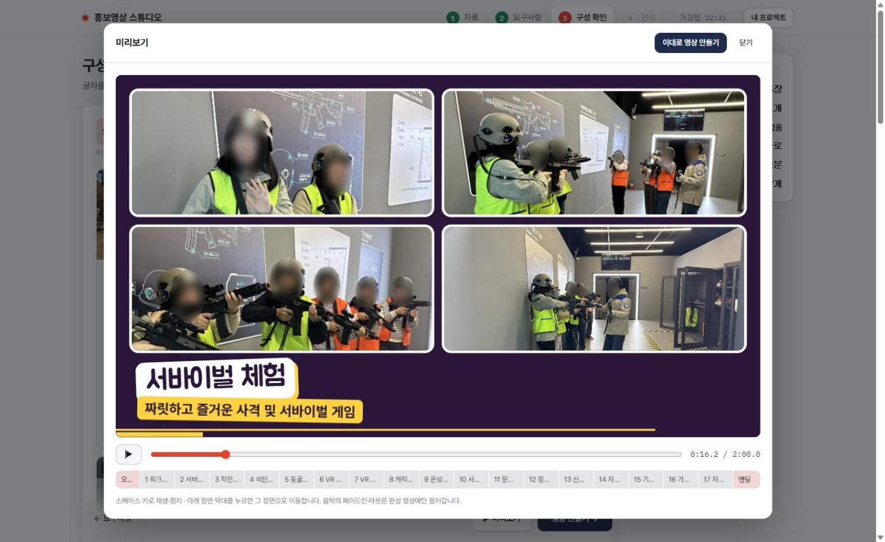

# createMovie

사진·배경음악을 올리면 AI(Gemini)가 장면을 구성하고 [HyperFrames](https://github.com/heygen-com/hyperframes)로 홍보 영상(MP4)을 렌더링하는 웹 서비스.

- 폴더째 드래그앤드롭 업로드, 배경음악 구간 편집, 영상 길이 15~600초
- AI 장면 구성·수정 요청, 장면별 화면 전환 효과, 브라우저 미리보기
- 가로(16:9)/세로(9:16), 한국어 내레이션(edge-tts), 프로젝트 저장·불러오기

## 연출 스타일 · 장면 유형
- **연출 스타일 4종**: 클래식 / 팝(귀엽고 경쾌) / 시네마틱(차분하고 진지, 레터박스) / 키네틱(빠르고 강렬, 글자 단위 등장).
  글꼴·색·글자 등장·사진 움직임·전환 묶음·속도가 한 벌로 바뀝니다. 요구사항 단계에서 고르거나 AI 추천에 맡기고, 구성 단계에서 언제든 바꿀 수 있어요.
- **장면 유형 5종**: 기본 / 사진 콜라주 / 큰 숫자 / 인용·후기 / 목록·일정. 숫자·후기는 요구사항에 실제로 적힌 내용만 씁니다.
- **장면 배치 A/B**: 같은 유형도 배치가 2가지(분할 화면, 폴라로이드, 카드형 목록 등)라 영상마다 반복 느낌이 줄어요.
- **박자 맞춤 편집**: 배경음악을 올리면 템포(BPM)와 마디를 자동으로 찾아, 장면이 바뀌는 순간을 비트(가능하면 마디 첫 박)에 맞춥니다. 음악 패널에서 끌 수 있어요.
- **동영상 클립**: MP4·MOV를 사진처럼 올려 장면에 쓸 수 있어요(배경음악과 섞이도록 소리는 끔). 장면보다 짧으면 천천히 재생하고 마지막 장면에서 멈춥니다.
- **얼굴 모자이크**: 사진 속 얼굴을 찾아 흐리게 처리(외부 게시용). 동영상 클립에는 적용되지 않아요.
- **세로 자동 맞춤**: 얼굴 위치를 기준으로 잘라 쇼츠·릴스에서 인물이 잘리지 않게 합니다.
- **로고**: 기관 로고를 올리면 오프닝·엔딩과 장면 구석에 넣어요(흰 배경 자동 제거).
- **자막**: 내레이션을 화면 자막으로 함께 넣어요(소리 없이 보는 SNS용).
- **가로 + 세로 동시 출력**: 한 번에 두 영상과 각각의 썸네일 이미지를 만듭니다.
- 글꼴은 `python tools/get_fonts.py`로 한 번 내려받으면(도커는 자동), 영상에 쓰인 글자만 잘라 넣기 때문에 렌더하는 PC에 글꼴을 설치할 필요가 없습니다.
- 배경음악이 없을 때는 `python tools/make_bgm.py bgm.wav 40`으로 저작권 걱정 없는 경쾌한 음악(128BPM)을 만들 수 있어요.

## 실행
필요: Python 3.11+, Node.js 22+, FFmpeg

```
pip install -r requirements.txt
python tools/get_fonts.py   # 영상용 한글 글꼴·얼굴 인식 모델(처음 한 번)
echo GEMINI_API_KEY=발급받은키 > .env
python server.py   # http://localhost:5000
```

## NAS + PC 렌더 워커 구성 (권장)
영상 렌더링은 CPU를 많이 써서, 사양이 낮은 NAS에서는 화면·AI 구성·저장만 하고 렌더링은 PC가 맡습니다.
PC가 NAS에 일감을 물어보는 방식이라 공유기 포트를 열 필요가 없고, PC가 꺼져 있으면 켜질 때까지 대기열에 남아 있습니다.

**1. NAS (Synology Container Manager)**
- 이 저장소를 NAS 폴더에 받고, 같은 폴더에 `.env` 작성:
  ```
  GEMINI_API_KEY=발급받은키
  WORKER_TOKEN=아무도-모르는-긴-문자열
  ```
- Container Manager > 프로젝트 > 생성 > `docker-compose.yml` 선택 > 빌드·실행
- 폰/PC 브라우저에서 `http://NAS주소:5000` 접속

**2. PC (Windows 10/11)**
- 브라우저에서 `http://NAS주소:5000/worker.zip` 내려받아 압축 풀기
- `setup-worker.bat` 더블클릭 → Node.js·FFmpeg 자동 설치, 토큰 입력, 시작 프로그램 등록까지 한 번에
- 이후 윈도우를 켜면 워커가 최소화 상태로 자동 실행됩니다(바탕화면 바로가기로도 실행 가능)
- macOS/Linux: Node.js 22+·FFmpeg 설치 후 `node worker.mjs --setup`, `node worker.mjs`

`WORKER_TOKEN`을 비워 두면 예전처럼 서버가 직접 렌더링합니다(PC 한 대로 쓸 때). 다른 기기에서 접속하려면 `.env`에 `HOST=0.0.0.0`.

---

# 개발일지

저장소: https://github.com/kjt7942/createMovie

## 목적
기관·단체의 행사 사진 폴더와 배경음악만 있으면, 영상 편집 지식 없이 홍보 영상(MP4)을 만들 수 있게 하는 것.
사진 폴더 하나가 장면 하나가 되고(`server.py` 프롬프트: "폴더 하나가 장면 하나"), 제목·슬로건·장면 문구는 Gemini가 사진 내용과 요구사항을 보고 짜 준다.
렌더링 CPU 부담이 커서 저사양 NAS에서도 쓸 수 있도록 화면·AI·저장(NAS)과 렌더링(PC)을 분리했다.

## 기획 단계
Claude 앱 대화(공유 링크 `https://claude.ai/share/abda216f-ffda-4657-8928-6f06f75ddf66`)에서 시작했다. 아래는 사용자가 보낸 메시지 원문이다(순서대로).

**① 최초 질문 — 서비스 가능 여부 (저장소 링크 `https://github.com/kjt7942/createMovie` 와 함께)**
> 이거 깃허브에서 서비스 할수있어?
> 그리고 ai가 필요한부분에서 사용자가 구독하는 ai를 연결할수있어?

→ 답변 요지: GitHub Pages는 정적 HTML만 가능해 불가, 구독형 AI는 API 권한이 없어 직접 연결 불가. 대안으로 사용자 API 키 입력(BYOK), NAS/VPS 배포 제시.

**② AI 엔진 관련**
> 그럼 이 소스코드를 내려받아서 클로드코드에서 실행하고, ai도 클로드코드를 이용하는건 가능하지?

**③ 모바일 / 앱화**
> 내 스마트폰에서 실행하려면 수정을 많이해야돼?

> 이걸 앱으로만들면?

**④ 부하 문제 → PC 렌더 워커 구조 결정**
> 기존 프로젝트를 나스에서 돌리면 부하가 많이 걸리는거 아냐?

> 나스는 사양이 낮아서 부하높은 서비스는 올리기힘들어
> 서비스는 나스에 하되, 부하가 걸리는작업은 pc에서 처리하도록 하는게 가장 맞을거같은데! 대신 pc에 설치할게 있다면 쉽게 처리할수있게 준비해야하겠다.

**⑤ 영상 포맷 다양화 요구 (장면 유형 도입의 계기)**
> 그리고 지금 영상제작하는 포맷이 항상 똑같은거 아니야?
> 타이틀,내용 형식의 반복이잖아!
> 다양한 포맷으로 동영상제작이 가능해야 주제에 맞게 변화를 줄수있을거같은데?!

**⑥ 샘플 영상 제작 요청 (축제 사진 업로드)**
> 얼마전 축제관련 사진이야.
> 모든 장면유형을 활용해서 샘플영상 만들어줘.
> 화려하고 스피디한 장면전환효과를 다양하게 섞어서 세련되게 생성해줘. 가능하다면 영상에 맞는 배경음악도 넣어줘.

**⑦ 애니메이션 반복 지적 → 연출 스타일 도입**
> 영상확인했어.
> 매번 생성하는 영상의 애니메이션 구성이 항상 비슷한데, 같은주제라서 그런거야? 아님 이렇게밖에 못하는거야?

> 지금 테스트영상을 또 뽑을필요는 없고, 서비스에 적용해줘

> 계속 진행해

**⑧ 추가 기능 선정** (Claude가 제안한 11개 중 선택)
> 더 필요한게 뭐가있을까?

> 4,5,6,7,8,9번 진행

→ 4 얼굴 모자이크 · 5 동영상 클립 · 6 로고 · 7 자막 · 8 세로 자동 맞춤 · 9 가로+세로 동시 출력·썸네일

**⑨ 화면 확인**
> 서비스 화면 볼수있어?

## 기술 스택 및 선택 이유
| 영역 | 사용 | 이유(코드 근거) |
|---|---|---|
| 서버 | Python · Flask | 업로드·AI 호출·대기열을 한 파일(`server.py`)로 처리 |
| 영상 | HyperFrames(HTML + GSAP 타임라인) | 장면을 HTML/CSS로 쓰고 `data-start`/`data-duration`으로 시간 지정 (`composer.py`) |
| AI | Gemini (모델 3종 순차 폴백, 키 여러 개 순환) | 사진을 직접 보고 장면·문구 구성 (`server.py`의 `gemini()`) |
| 내레이션 | edge-tts | 무료·키 불필요, 한국어 3종 목소리 |
| 음악 박자 | numpy 기반 분석 (`beats.py`) | 장면 전환을 비트에 맞춤 |
| 얼굴 | YuNet ONNX (`media.py`) | 세로 자동 맞춤·얼굴 모자이크 |
| 렌더 워커 | Node.js 22+ · FFmpeg (`worker/worker.mjs`) | 외부 패키지 없이 PC에서 렌더 후 서버로 업로드 |
| 배포 | Docker (Synology Container Manager) | NAS 상시 실행 |

## 개발 기록 (git 커밋 시각 기준)
| 시각 | 내용 |
|---|---|
| 10/29 18:01 | 첫 커밋. HyperFrames 기반 홍보영상 제작 웹서비스(업로드 → AI 구성 → 렌더 → 미리보기) |
| 10/30 00:26 | 렌더링을 PC 워커로 분리. NAS는 화면·AI·저장만, PC가 `/claim`으로 일감을 가져가는 방식 |
| 10/30 00:38 | 장면 유형 5종(기본·콜라주·큰 숫자·인용·목록)과 빠른 전환 3종(휙·플래시·회전 줌), 무료 BGM 생성기 |
| 10/30 01:20 | 연출 스타일 4종·장면 배치 A/B·장면 유형 편집 화면. 템플릿 로직을 `composer.py`로 분리 |
| 10/30 09:22 | 배경음악 박자 분석(`beats.py`)으로 장면 전환을 비트에 맞춤 |
| 10/30 10:05 | 동영상 클립, 얼굴 모자이크, 세로 자동 맞춤, 로고, 자막, 가로+세로 동시 출력 |
| 10/30 21:57 | Gemini API 키 여러 개를 호출마다 돌려 쓰고 실패 시 다음 키로 재시도 |
| 10/30 22:07 | 콜라주 장면 챕터 진행바가 전체 진행바와 겹치는 문제 수정 |

## 트러블슈팅 · 배운 점
- **영상이 매번 똑같아 보임**: 초기에는 `base_template.html` 하나로 오프닝 → 번호+제목 → 엔딩 구조가 고정이었다. 연출 스타일 4종, 장면 유형 5종, 배치 A/B를 도입해 조합이 달라지게 했다(`composer.py`).
- **AI 사용량 한도**: 모델 3종을 순서대로 시도하던 것에 더해, `.env`의 `GEMINI_API_KEY`, `GEMINI_API_KEY_2`… 를 호출마다 시작 키를 바꿔 쓰고 실패하면 다음 키로 넘어가게 했다(`server.py` `api_keys()`, `gemini()`). 실패 메시지에 어느 키(끝 4자리)에서 실패했는지 남긴다.
- **LLM이 한글을 한자로 바꿔 씀**: 가끔 "온"→"溫"처럼 나와서 CJK 한자 범위를 제거하는 `clean()`으로 후처리 (`server.py`). 프롬프트에도 한자 금지를 명시.
- **세로 영상에서 문구 줄바꿈**: 폭이 좁아 긴 문구가 줄바꿈되므로 세로일 때 title 6자, 장면 제목 8자 이내로 AI에 요구하고, 사진은 인물이 가운데 있는 것을 고르게 했다.
- **내레이션이 장면보다 길어짐**: 초당 4.6자(edge-tts 한국어 3종 실측 4.6~4.9)로 글자 수 예산을 AI에 주고, 넘치면 최대 +40%까지 빠르게 다시 합성, 그래도 길면 구간 끝에서 자른다(`make_narration`).
- **서버 재시작 시 대기열 유실 방지**: 렌더 상태를 작업 폴더의 `render.json`에 저장. 워커가 10분(`STALE`) 동안 진행 보고가 없으면 꺼진 것으로 보고 다시 대기열에 넣는다.
- **공유기 포트 개방 없이 PC 렌더**: 서버가 PC를 부르는 대신 PC가 서버에 일감을 물어보는(pull) 구조로 해결.
- **전체 진행바와 챕터 진행바 겹침**: 콜라주 장면의 챕터 진행바(`.cbar`)가 화면 맨 아래(`bottom: 0`)라 전체 진행바(`#progress`, 8~14px)와 같은 자리에 겹쳤다. 아래에서 18px 띄우고 6px로 줄여 분리했다(`composer.py`).
- **브랜치 병합**: 기능 브랜치 `scene-formats`(`pc-render-worker` 포함)를 `main`에 합치면서 `server.py`의 로컬 수정(키 순환)과 충돌해, `api_key()`를 `api_keys()`로 대체하는 방향으로 수동 정리했다. 접속 주소 기본값이 `127.0.0.1`로 바뀌어 외부 기기 접속에는 `HOST=0.0.0.0`이 필요하다.

## 결과물
**미리보기 — 콜라주 장면 + 얼굴 모자이크**
요구사항 단계에서 `사진 속 얼굴 흐리게`를 켜면 사진 속 얼굴이 자동으로 흐려진다(YuNet 얼굴 감지). 연출 스타일은 팝, 장면 유형은 사진 콜라주(4장).



> TODO: 완성 영상(가로/세로)과 연출 스타일 4종 비교 캡처는 얼굴이 없는 사진으로 만든 샘플로 추가 예정. 현재 캡처는 얼굴이 모두 가려진 장면만 사용했다.

## 향후 계획
- 동영상 클립에는 얼굴 모자이크가 적용되지 않음(위 기능 설명 참고).
- 렌더 락이 서버에서 1건씩만 직렬 처리(`_render_lock`). 동시 사용자가 늘면 작업 큐 필요.
- API 키 순환의 시작 위치가 프로세스 메모리에만 있어 재시작하면 첫 키부터 다시 시작.
- 테스트는 `test_*.py` 스크립트 수준이며 자동 실행(CI) 설정은 없음.
